# 05 - FLUJOS DE PROCESOS
## Sistema de Facturación Electrónica B2B

**Versión:** 1.0.0  
**Última actualización:** 17 de Diciembre, 2025

---

## 📋 Tabla de Contenidos

1. [Introducción](#introducción)
2. [Flujo de Autenticación](#flujo-de-autenticación)
3. [Flujo de Creación de Cliente](#flujo-de-creación-de-cliente)
4. [Flujo de Creación de Producto](#flujo-de-creación-de-producto)
5. [Flujo de Emisión de Factura](#flujo-de-emisión-de-factura)
6. [Flujo de Registro de Pago](#flujo-de-registro-de-pago)
7. [Flujo de Generación de Reportes](#flujo-de-generación-de-reportes)
8. [Flujo de Backup](#flujo-de-backup)
9. [Flujo de Exportación](#flujo-de-exportación)
10. [Flujo de Integración SII](#flujo-de-integración-sii)

---

## 🎯 Introducción

Este documento describe los flujos de procesos clave del sistema mediante diagramas Mermaid. Cada flujo muestra la secuencia de acciones desde la interacción del usuario hasta la persistencia de datos.

### Convenciones

- **Rectángulos:** Procesos/Acciones
- **Rombos:** Decisiones
- **Cilindros:** Base de datos
- **Flechas:** Flujo de control

---

## 🔐 Flujo de Autenticación

### Primera Ejecución (Registro)

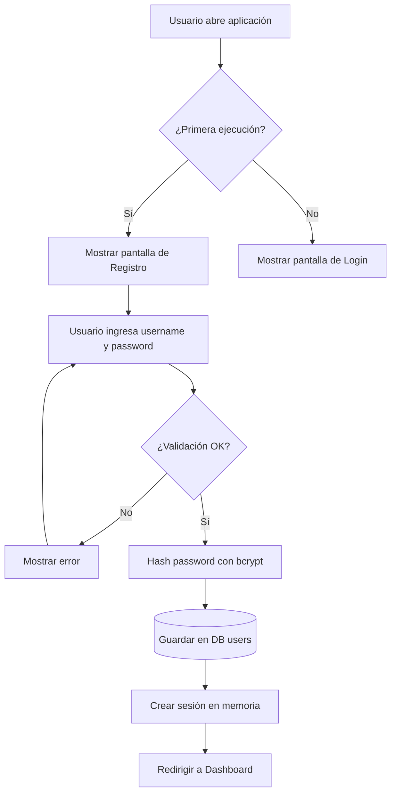

### Login

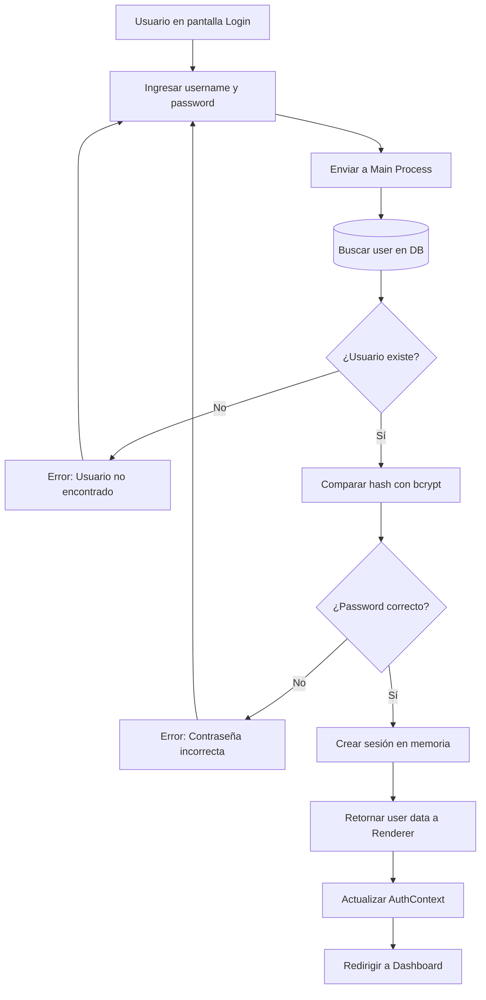

### Logout

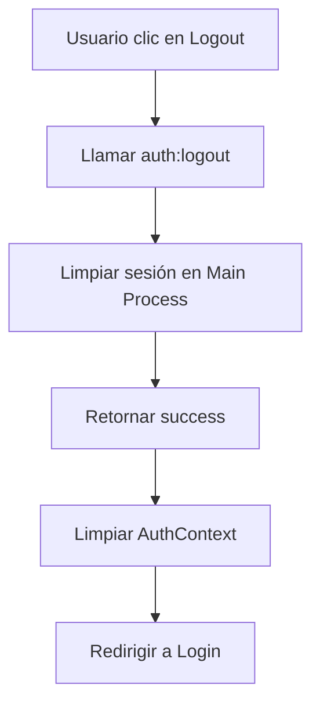

---

## 👥 Flujo de Creación de Cliente

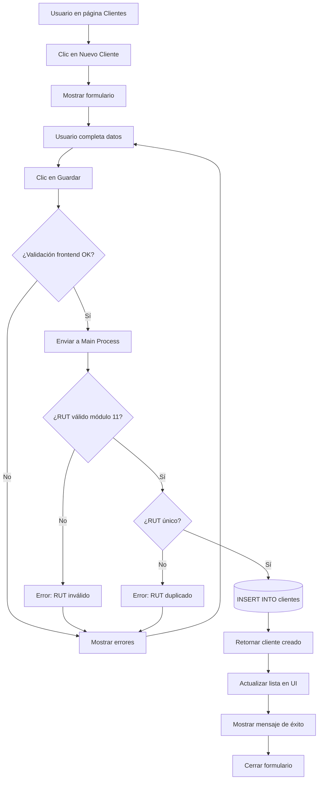

---

## 📦 Flujo de Creación de Producto

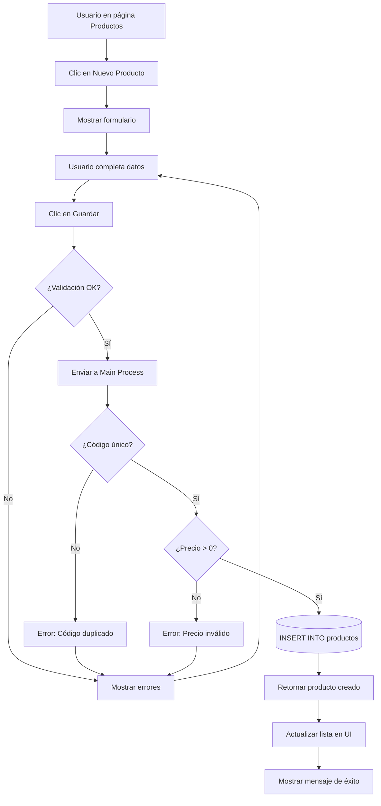

---

## 📄 Flujo de Emisión de Factura

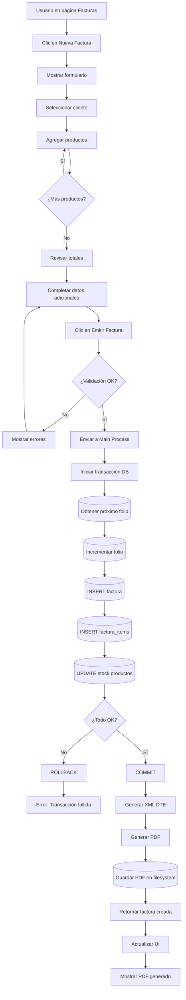

### Detalle: Transacción de Factura

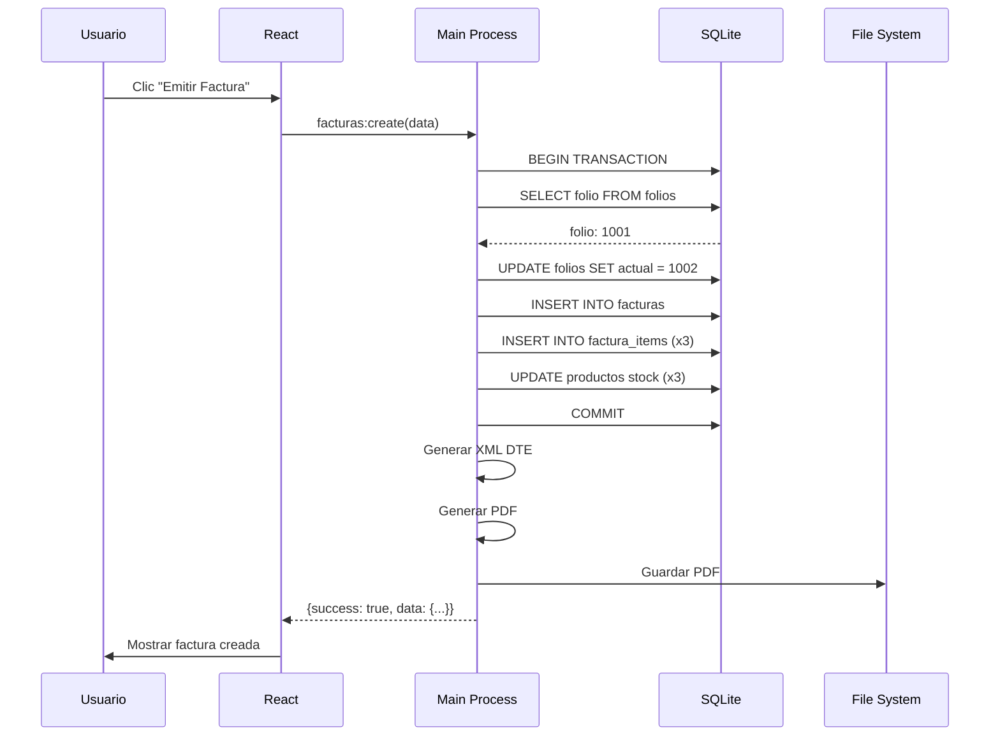

---

## 💰 Flujo de Registro de Pago

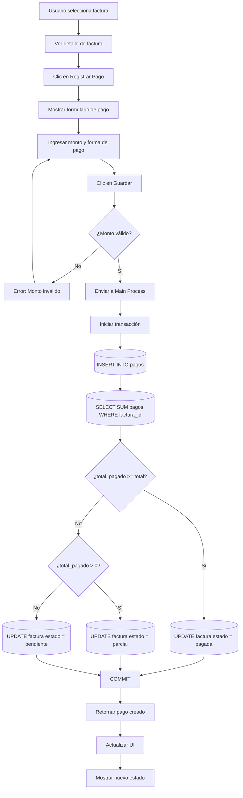

---

## 📊 Flujo de Generación de Reportes

### Reporte de Ventas

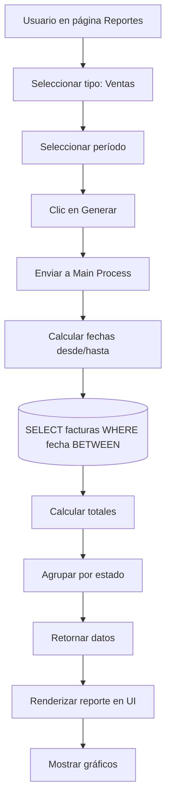

### Reporte Tributario

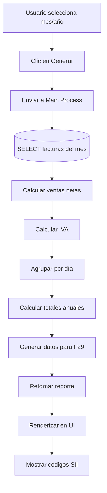

---

## 💾 Flujo de Backup

### Backup Automático

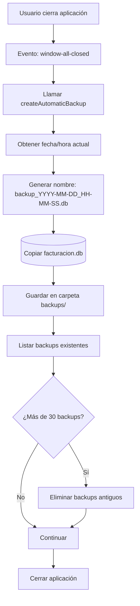

### Restauración

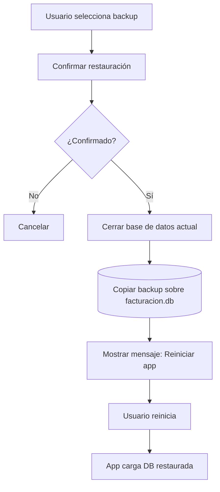

---

## 📤 Flujo de Exportación

### Exportar a Excel

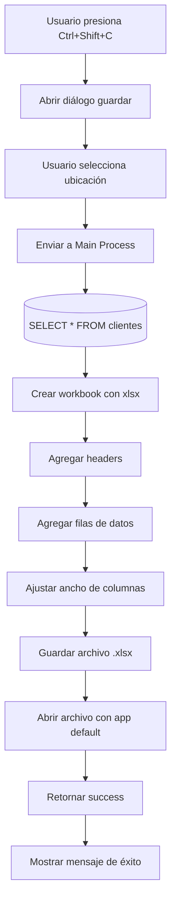

---

## 🏛️ Flujo de Integración SII

### Envío de DTE (Futuro)

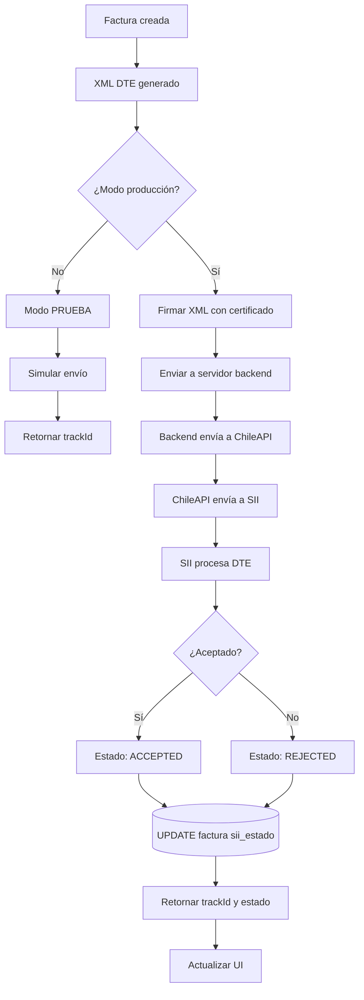

### Consulta de Estado

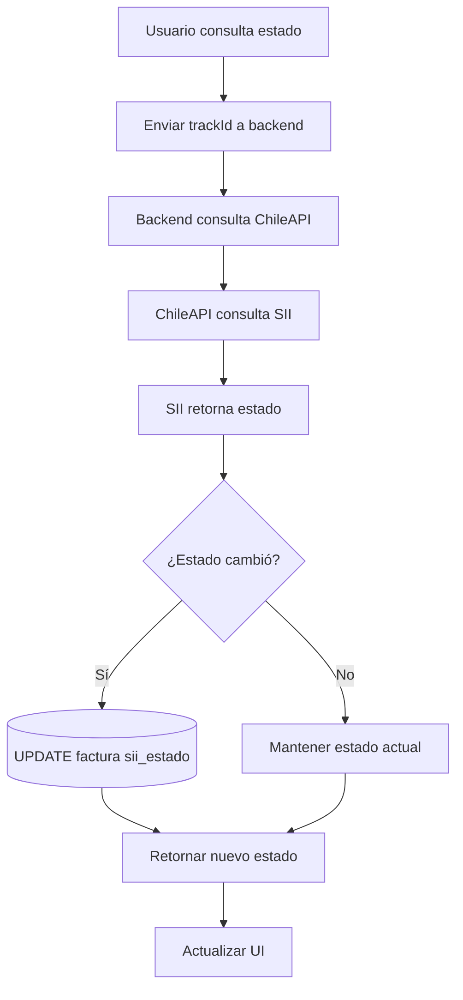

---

## 🔄 Flujo de Actualización de Stock

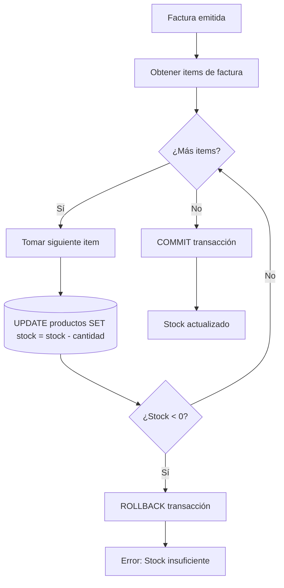

---

## 📱 Flujo de Navegación (SPA)

```mermaid
flowchart TD
    A[Usuario autenticado] --> B[Dashboard]
    B --> C{Selecciona opción}
    C -->|Clientes| D[/clientes]
    C -->|Productos| E[/productos]
    C -->|Facturas| F[/facturas]
    C -->|Vendedores| G[/vendedores]
    C -->|Reportes| H[/reportes]
    C -->|Configuración| I[/configuracion]
    
    D --> J[Cargar datos clientes]
    E --> K[Cargar datos productos]
    F --> L[Cargar datos facturas]
    G --> M[Cargar datos vendedores]
    H --> N[Mostrar opciones reportes]
    I --> O[Mostrar configuración]
    
    J --> P[Renderizar lista]
    K --> P
    L --> P
    M --> P
    N --> P
    O --> P
```

---

## 🔍 Flujo de Búsqueda

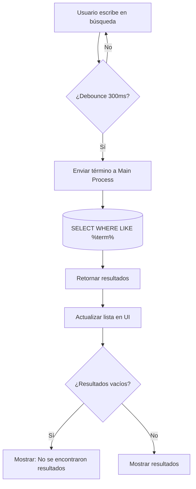

---

## 🎨 Flujo de Renderizado de Dashboard

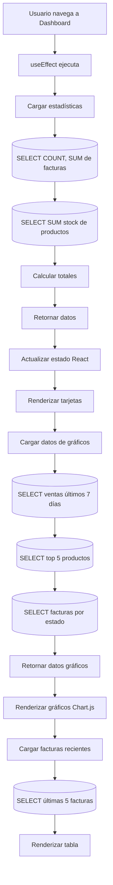

---

## 📝 Notas de Implementación

### Transacciones ACID

Todos los flujos que modifican múltiples tablas usan transacciones:
- Creación de factura (factura + items + stock)
- Registro de pago (pago + estado factura)

### Validación en Dos Niveles

1. **Frontend (React):** Validación básica para UX
2. **Backend (Main):** Validación completa para seguridad

### Manejo de Errores

Todos los flujos incluyen manejo de errores:
- Try-catch en handlers
- Rollback automático en transacciones
- Mensajes de error descriptivos

---

## 🔗 Referencias

- [Manual Técnico](./07-MANUAL_TECNICO.md) - Implementación de flujos
- [API IPC](./04-API_IPC.md) - Handlers utilizados
- [Arquitectura](./02-ARQUITECTURA.md) - Visión general del sistema

---

**Última actualización:** 17 de Diciembre, 2025  
**Versión:** 1.0
